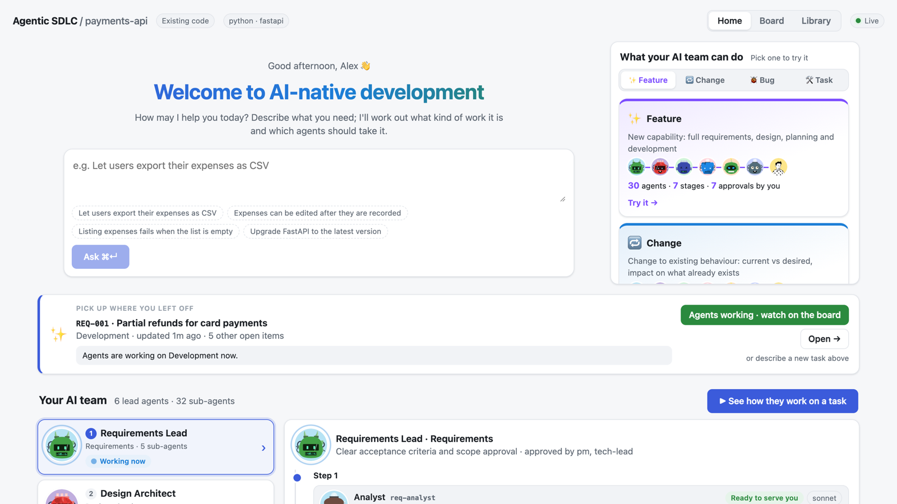
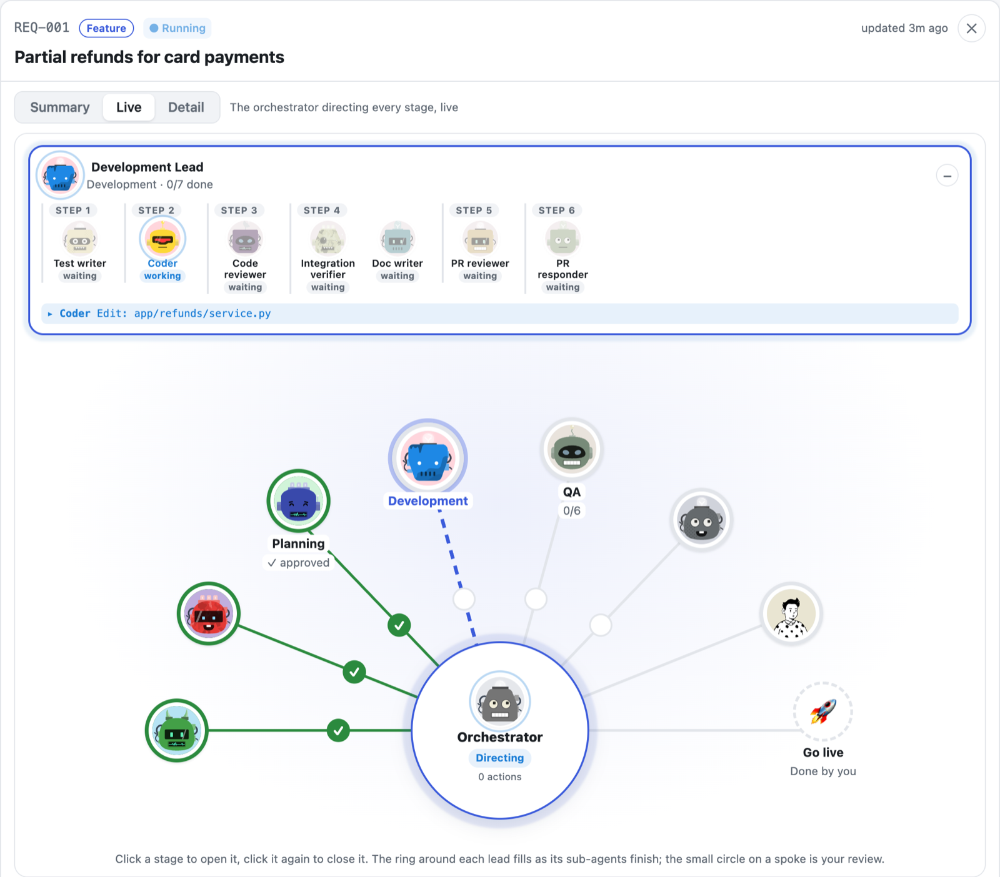
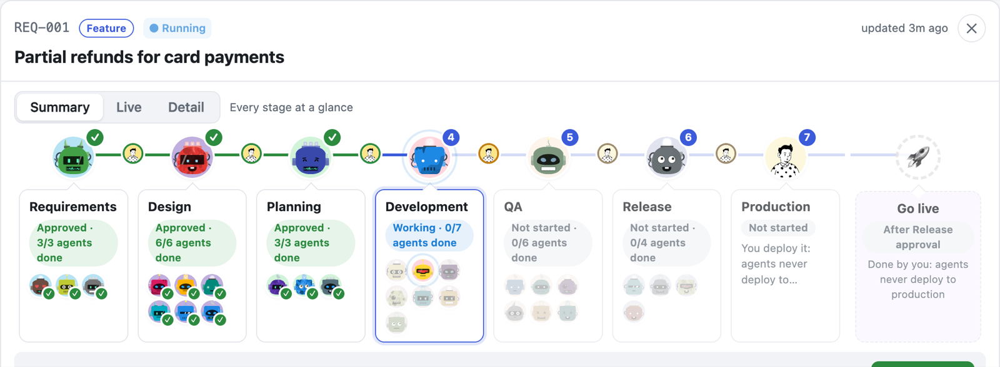
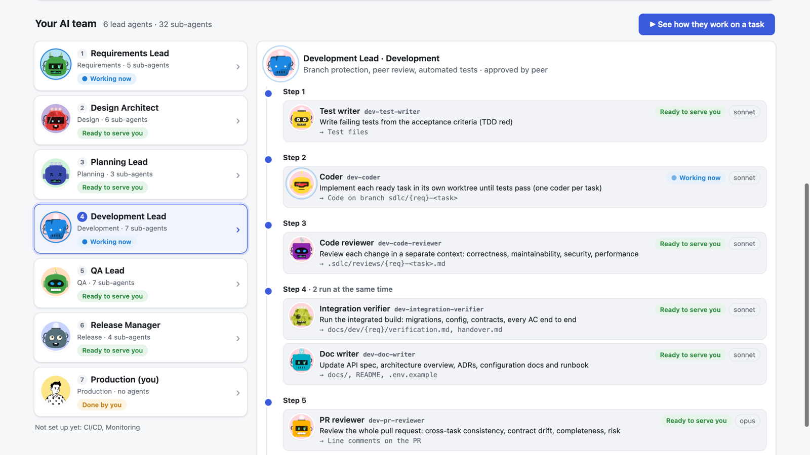
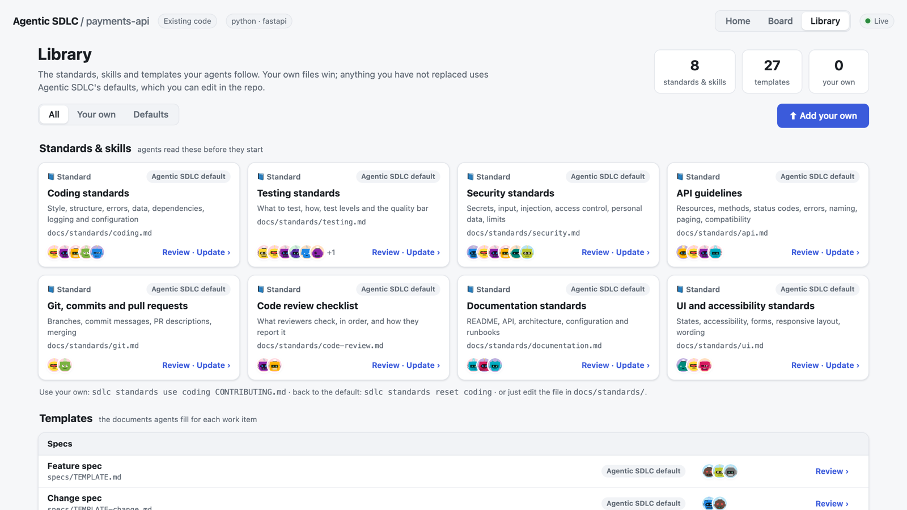

# Agentic SDLC

**AI agents run your software lifecycle. People approve every gate.**

Agentic SDLC turns a request like *"Let users export their expenses as CSV"* into reviewed, tested, released
software, in any repo, new or existing. A team of specialised Claude Code agents does the work at each stage
(requirements, design, planning, development, QA, release). An orchestrator directs them. You approve each stage,
and you, never an agent, take it to production.

```
You ask  →  Requirements  →  Design  →  Planning  →  Development  →  QA  →  Release  →  🚀 You go live
                   👤 you approve after every stage
```

- **32 agents, one per job:** analyst, architect, security reviewer, test writer, coders working in parallel,
  code and PR reviewers, functional, security, UAT and performance testers, release verifiers and more.
- **People stay in charge:** approvals, risk decisions and production deploys are human-only. The engine
  enforces this, whatever AI tool is used.
- **A live dashboard:** describe the work in plain words, watch the orchestrator and its agents work, approve
  from the browser, and see AI cost per item, stage and agent.
- **Your rules:** agents follow your coding, testing, security and API standards, or sensible defaults you can
  edit, and fill your templates.
- **Evidence for every step:** specs, designs, plans, test reports, checks, a pull request per work item and
  release notes, all as files in your repo.



**See it working:** [agentic-sdlc-demo](https://github.com/vks-app-dev/agentic-sdlc-demo) is a small app with
finished work items you can explore, and requests ready to try.

## Quick start

You need [Claude Code](https://claude.com/claude-code), [uv](https://docs.astral.sh/uv/), git, and optionally
the GitHub CLI (`gh`) for pull requests.

**1. Install once per machine**

```bash
uv tool install git+https://github.com/vks-app-dev/agentic-sdlc@v0.8.0   # the `sdlc` command
claude plugin marketplace add vks-app-dev/agentic-sdlc                    # the agents
claude plugin install agentic-sdlc@agentic-sdlc
sdlc --version
```

**2. Set up a repo (existing or new)**

```bash
cd your-repo            # a new repo: `git init` and make a first commit first
claude                  # then type: /agentic-sdlc:sdlc-init
sdlc doctor             # checks that everything is ready
```

Setup scans the code, detects the stack and its test, lint and run commands, and asks a few questions (who
approves, which stages, your own standards). It adds only:

- `sdlc.config.yaml`;
- a `.sdlc/` folder;
- `docs/standards/` and templates;
- a section in `CLAUDE.md`.

Your code is not changed.

**3. Give it work**

```bash
sdlc dashboard          # opens http://127.0.0.1:8765
```

On **Home**, describe what you need. Agentic SDLC sorts it into a feature, change, bug or task and shows which
agents will work on it and where you approve. Press **Create and start the agents**, then watch it on the
**Board**. In Claude Code you can do the same with `/agentic-sdlc:sdlc-new "title"` and
`/agentic-sdlc:sdlc-run REQ-001`.

## A look around

**Watch the agents work.** The Live view puts the orchestrator in the centre and every stage around it. The stage
in focus shows its sub-agents step by step: who is working, what they are doing, and who is waiting.



**Every work item at a glance.** The stages it goes through, each stage's agents and their progress, your reviews
between stages (✓ once approved), and the go-live step that is always yours.



**Your AI team.** One lead per stage and its sub-agents, in the order they run.



**Your rules.** The Library holds the standards and templates agents follow. Review, download or upload your own
version, or add a new standard or skill for the agents you choose.



## How it works

| Part | What it is |
| --- | --- |
| `sdlc` command | The engine: config, work-item state, gates, the task plan, checks, pull requests, releases. Agents and people both use it, and it refuses human-only actions from agents. |
| Claude Code plugin | The agents, the `/agentic-sdlc:*` commands and hooks that record what every agent does. |
| Dashboard | The web app (`sdlc dashboard`): Home, Board with live and summary views, and a Library of standards and templates. |

**Work types**

| Type | Stages |
| --- | --- |
| Feature | All stages |
| Change | Design only when it is big enough |
| Bug | Starts with triage and a reproduction |
| Task | Upgrades and refactors: development, QA and release |

**Production** is always deployed by a person. Agents deploy only to your test and staging environments.

## Safety

- Gates (approve or send back), decisions about known defects, and production deploys are human-only. From an
  agent they are refused or turned into a request a person must confirm.
- Headless agent runs may only use your project's own commands, `git`, `sdlc` and your package manager's
  dependency commands. A hook blocks production deploy commands.
- A built-in secret scan and your configured checks (tests, lint, audit, SAST) must pass before Development can
  be approved.

## Docs

- [Reference](docs/REFERENCE.md): every command, stage, check and setting.
- [Rolling it out across a company](docs/DISTRIBUTION.md): policy, version pins, portfolio view.
- [Company policy example](docs/org.example.yaml).
- [Changelog](CHANGELOG.md).

GitHub Copilot users can run the same agents through the `sdlc mcp` server; see the reference.

## Status and contributing

Early (0.x): it works end to end on real projects, but expect changes. Issues and pull requests are welcome. Run
`uv sync --extra dev && uv run pytest` before opening one, and `cd dashboard && npm ci && npm run build` if you
change the UI.

## License

MIT. The agent avatars use the [DiceBear](https://www.dicebear.com/) "Bottts" style by Pablo Stanley, free for
personal and commercial use.
